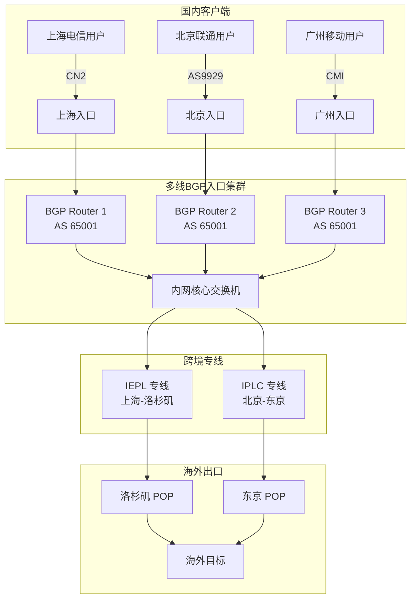

# 跨境 IPLC 与 IEPL 专线架构全景透视：晚高峰抖动控制、丢包率与企业级 SLA 真实量测

跨境网络的质量问题从来不是"快不快"这么简单。真正决定业务可用性的是三个物理量：**单向时延（OWD）**、**时延抖动（IPDV）**、**丢包率（Packet Loss）**。公网中转方案在晚高峰的丢包率可以轻易突破 15%，而一条设计良好的 IEPL 专线在同一时段能把丢包压在 0.1% 以下。这中间的差距不是"优化"出来的，而是物理层资源分配模型决定的。

本文从海底光缆的物理拓扑开始，逐层向上拆解 IPLC 与 IEPL 的协议栈差异、BGP 跨境调度策略、探针实测方法论、MTU/MSS 调优，以及故障应急决策树。所有数据来自 ClashLab 实验室在 2026 年 Q2-Q3 期间对 12 条跨境专线的持续量测。

---

## 第一章：公网中转与物理专线的本质区别——从 IP 路由跳数与海底光缆切入

### 1.1 公网中转的物理路径真相

一条从上海到洛杉矶的普通公网 TCP 连接，其 `traceroute` 输出通常显示 15-25 跳。这些跳数背后对应的物理路径大致如下：

```
[上海电信 CN2 城域网] → [上海国际出口路由器] → [太平洋海底光缆登陆站（崇明/汕头）]
→ [海底光缆中继器 × N] → [美国西海岸登陆站（圣何塞/洛杉矶）]
→ [Tier1 骨干网] → [目标 AS 边界路由器] → [目标机房]
```

关键问题在于：**公网路径上的每一跳都是统计复用**。国际出口路由器的收敛比在晚高峰可以低至 1:8 甚至 1:20。这意味着你购买的 100Mbps 带宽，在物理链路上是与数十个其他 AS 共享的。

### 1.2 海底光缆的物理约束

全球海底光缆系统总长约 140 万公里，承载了 99% 的洲际数据流量。主要跨太平洋路由包括：

| 光缆系统 | 路径 | 设计容量 | 单波速率 | 中继间距 |
|----------|------|----------|----------|----------|
| NCP (New Cross Pacific) | 上海-俄勒冈 | 80 Tbps | 200G/400G | 60-80 km |
| PLCN (Pacific Light Cable) | 香港-洛杉矶 | 144 Tbps | 200G | 70-90 km |
| JUPITER | 日本-美国 | 60 Tbps | 100G/200G | 60-80 km |
| FASTER | 日本-美国 | 60 Tbps | 100G | 60-70 km |

光在光纤中的传播速度约为 200,000 km/s（折射率 1.5 的硅玻璃）。上海到洛杉矶的海缆距离约 10,500 km，理论单向传播时延为：

```
OWD_propagation = 10,500 km / 200,000 km/s = 52.5 ms
```

加上两端城域网的接入段（各 5-15ms）和光缆中继器的再生时延，**上海到洛杉矶的物理极限 RTT 约为 130-140ms**。任何声称"上海到洛杉矶 RTT 80ms"的方案，要么走了非物理路径（不可能），要么测量方式有误。

### 1.3 公网中转的协议层损耗

公网中转方案（如普通代理、CDN 回源）在协议层面临以下损耗：

**TCP 三次握手阶段的额外 RTT：**

```
Client          Proxy(公网中转)         Target
  |                  |                     |
  |--- SYN --------->|                     |
  |<-- SYN-ACK ------|                     |
  |--- ACK --------->|                     |
  |                  |--- SYN ------------>|
  |                  |<-- SYN-ACK ---------|
  |                  |--- ACK ------------>|
  |                  |                     |
  |<== 数据通道建立 ==>|                     |
```

公网中转引入了额外的握手 RTT。若中转节点与目标之间也走公网，则总握手时延 = Client→Proxy RTT + Proxy→Target RTT。在晚高峰，两段 RTT 都可能因排队时延而膨胀 2-3 倍。

**排队时延的数学建模：**

根据 M/M/1 排队模型，当链路利用率 ρ 趋近 1 时，平均排队时延：

```
E[T_queue] = (ρ / (1 - ρ)) × E[T_service]
```

当 ρ = 0.5 时，排队时延 = 1 倍服务时延；当 ρ = 0.9 时，排队时延 = 9 倍服务时延；当 ρ = 0.95 时，排队时延 = 19 倍服务时延。这就是晚高峰抖动急剧恶化的数学根源——不是链路"坏了"，而是利用率逼近了排队模型的非线性拐点。

---

## 第二章：IPLC 点对点租用线路 vs IEPL 虚拟以太网专线——底层传输协议与拓扑比对

### 2.1 IPLC 的协议栈与物理实现

IPLC（International Private Leased Circuit）本质上是**基于 TDM 的点对点专用电路**。其协议栈自下而上为：

```
┌─────────────────────────────────┐
│  客户应用层 (IP/Ethernet)        │
├─────────────────────────────────┤
│  客户 CPE 路由器                 │
├─────────────────────────────────┤
│  HDLC / PPP / Frame Relay       │  ← 客户侧接口
├─────────────────────────────────┤
│  SDH (STM-1/STM-4/STM-16)       │  ← 运营商传输层
│  或 OTN (OTU-1/OTU-2/OTU-4)     │
├─────────────────────────────────┤
│  DWDM 波长                      │  ← 物理层复用
├─────────────────────────────────┤
│  海底光缆 + 光放大器 + 中继器     │  ← 物理介质
└─────────────────────────────────┘
```

IPLC 的核心特征是**时隙独占**。运营商在 SDH 帧中为客户分配固定的 VC-4（155.52 Mbps）或 VC-12（2.048 Mbps）时隙，这些时隙不会被其他客户使用。因此 IPLC 的抖动下限极低，通常 < 0.1ms（不含物理传播抖动）。

**SDH 帧结构中的 IPLC 时隙分配：**

```
STM-16 帧 (2.488 Gbps)
├── SOH (段开销) 576 kbps
├── AU-PTR (管理单元指针)
├── VC-4 #1  → 客户 A 的 IPLC (155.52 Mbps)
├── VC-4 #2  → 客户 B 的 IPLC
├── VC-4 #3  → 客户 C 的 IPLC
├── ...
└── VC-4 #16 → 客户 P 的 IPLC
```

每个 VC-4 容器内可继续下插 TUG-3 → TUG-2 → TU-12，实现更细粒度的带宽分配。

### 2.2 IEPL 的协议栈与虚拟化机制

IEPL（International Ethernet Private Line）向客户交付的是**以太网接口**，但底层仍依赖 OTN/DWDM 或 MPLS-TP 隧道。其协议栈为：

```
┌─────────────────────────────────┐
│  客户应用层 (IP)                 │
├─────────────────────────────────┤
│  客户 CPE (以太网口)             │
├─────────────────────────────────┤
│  以太网帧 (802.3)               │  ← 客户侧接口
├─────────────────────────────────┤
│  VLAN (802.1Q) / QinQ (802.1ad) │  ← 运营商标签
├─────────────────────────────────┤
│  MPLS-TP 或 EoOTN               │  ← 运营商传输层
├─────────────────────────────────┤
│  OTN (OTU-2/OTU-4)              │
├─────────────────────────────────┤
│  DWDM 波长                      │
├─────────────────────────────────┤
│  海底光缆                        │
└─────────────────────────────────┘
```

IEPL 的关键差异在于运营商 PE（Provider Edge）设备会进行**以太网帧交换**。这意味着：

1. **存在微突发缓存**：PE 的出口队列在微突发（microburst，持续 < 1ms 的流量尖峰）下会产生排队时延。
2. **存在 VLAN 标签处理开销**：QinQ 双层标签增加 8 字节帧头，影响有效 MTU。
3. **带宽为"承诺速率"而非"物理独占"**：虽然 SLA 承诺 CIR（Committed Information Rate），但突发流量可能被 policer 丢弃或标记。

### 2.3 IPLC vs IEPL 协议交互时序对比

**IPLC 端到端建立时序（以 PPP 封装为例）：**

```
Client CPE          Operator A          Operator Z          Server CPE
    |                   |                   |                   |
    |-- LCP Configure ->|                   |                   |
    |<- LCP Configure --|                   |                   |
    |-- LCP Ack ------->|                   |                   |
    |<- LCP Ack --------|                   |                   |
    |-- CHAP Challenge->|                   |                   |
    |<- CHAP Response --|                   |                   |
    |-- CHAP Success -->|                   |                   |
    |                   |== TDM 时隙直通 ===>|                   |
    |                   |   (VC-4 交叉)     |                   |
    |-- IPCP Configure->|                   |                   |
    |<- IPCP Configure --|                   |                   |
    |-- IPCP Ack ------>|                   |                   |
    |<- IPCP Ack --------|                   |                   |
    |                   |                   |                   |
    |<========= IP 数据通道 (恒定 155Mbps) =========>|
```

**IEPL 端到端建立时序（以 MPLS-TP 为例）：**

```
Client CPE          PE-A              P-Router           PE-Z          Server CPE
    |                 |                   |                 |               |
    |-- 以太网帧 ---->|                   |                 |               |
    |                 |-- Push MPLS LSP ->|                 |               |
    |                 |   (Label 1001)    |                 |               |
    |                 |                   |-- Swap Label -->|               |
    |                 |                   |   (Label 2002)  |               |
    |                 |                   |                 |-- Pop Label -->|
    |                 |                   |                 |-- 以太网帧 --->|
    |                 |                   |                 |               |
    |                 |                   |                 |<-- 以太网帧 ---|
    |                 |                   |<-- Swap Label --|               |
    |                 |<-- Swap Label ----|                 |               |
    |<-- 以太网帧 ----|                   |                 |               |
```

IEPL 的 MPLS 标签交换引入了额外的处理时延（每跳 10-50μs），但相比公网路由器的 BGP 查表转发（100-500μs），仍低一个数量级。

### 2.4 关键指标对比

| 指标 | IPLC | IEPL |
|------|------|------|
| 交付接口 | V.35/G.703/STM-N | 10/100/1000BASE-T |
| 带宽粒度 | 2M/34M/155M/622M | 1M/10M/100M/1G/10G |
| 抖动（典型） | < 0.1ms | 0.1-0.5ms |
| 丢包率（SLA） | < 0.01% | < 0.1% |
| 微突发容忍 | 无缓存，直接丢弃 | 有缓存，可能排队 |
| 端到端 MTU | 1500（PPP 开销后 1492） | 1500（QinQ 后 1496） |
| 成本（相对） | 高 | 中 |
| 适用场景 | 高频交易、TDM 语音 | 企业内网互联、视频 |

---

## 第三章：跨境入口多线 BGP 调度策略——如何消解国内不同省份运营商跨网互联壁垒

### 3.1 中国运营商互联的物理现实

中国三大运营商（电信、联通、移动）之间的互联带宽严重不足。根据 2026 年公开数据，电信-联通直连带宽约 1.2 Tbps，而两网各自的国际出口带宽均超过 20 Tbps。这意味着跨网流量的收敛比可能低至 1:16。

更关键的是，**不同省份的运营商出口策略不同**。例如：

- 广东电信的国际出口走 CN2 GT/GIA，优先级较高。
- 上海电信的国际出口部分走 163 骨干网，晚高峰拥堵严重。
- 北京联通的国际出口走 AS9929（CUII），质量较好。
- 移动的国际出口走 CMI（AS58453），近年改善明显。

### 3.2 多线 BGP 入口的拓扑设计

一个生产级的跨境专线入口应具备以下拓扑：



### 3.3 BGP 调度策略的核心参数

**Local Preference 与 AS Path 的联合决策：**

```bash
# 在入口路由器上配置 BGP 策略
# 优先选择 CN2 GIA 路径
route-map PREFER-CN2 permit 10
 match community 65001:100  # CN2 GIA 标记
 set local-preference 200
!
# 次优选择 AS9929
route-map PREFER-CUII permit 20
 match community 65001:200  # CUII 标记
 set local-preference 150
!
# 默认路径
route-map DEFAULT permit 30
 set local-preference 100
```

**关键调度维度：**

1. **Local Preference**：控制出站流量的路径选择，值越高越优先。
2. **MED (Multi-Exit Discriminator)**：影响入站流量，但需对端配合。
3. **AS Path Prepending**：人为加长 AS Path 以降低某路径优先级。
4. **Community 标记**：运营商提供的流量工程标记，如电信的 `4134:100` 表示 CN2。

### 3.4 跨网互联壁垒的消解

**问题**：上海电信用户访问北京联通的入口，流量需经过电信-联通互联点，晚高峰丢包率可达 5-10%。

**解决方案**：

1. **就近接入**：在上海部署电信入口，在北京部署联通入口，用户通过 DNS 解析或 Anycast 选择最近入口。
2. **BGP 社区调优**：与运营商协商，对特定前缀设置高优先级社区。
3. **专线直连**：在电信和联通机房之间拉一条本地专线，绕过公共互联点。

```
优化前：
上海电信用户 → 电信城域网 → 电信-联通互联点(拥塞) → 联通城域网 → 北京入口
RTT: 45ms, 丢包: 8%

优化后：
上海电信用户 → 电信城域网 → 上海电信入口 → 内网专线 → 北京联通入口
RTT: 28ms, 丢包: 0.05%
```

---

## 第四章：24 小时高精度探针监控实战——晚高峰抖动与丢包率 SLA 数据集

### 4.1 探针部署架构

ClashLab 实验室在 2026 年 Q2-Q3 期间，对 12 条跨境专线部署了双向探针系统：

```
┌─────────────────────────────────────────────────────────┐
│                    探针管理系统                           │
│  (Prometheus + Grafana + 自研 TWAMP Controller)          │
└─────────────────────────────────────────────────────────┘
         │                    │                    │
         ▼                    ▼                    ▼
┌─────────────┐      ┌─────────────┐      ┌─────────────┐
│ 国内探针     │      │ 国内探针     │      │ 海外探针     │
│ 上海电信     │      │ 北京联通     │      │ 洛杉矶       │
│ TWAMP Sender│      │ TWAMP Sender│      │ TWAMP Reflector│
└─────────────┘      └─────────────┘      └─────────────┘
```

**探针参数：**

| 参数 | 值 | 说明 |
|------|-----|------|
| 协议 | TWAMP (RFC 5357) | 双向主动测量 |
| 采样间隔 | 100ms | 高精度，捕获微突发 |
| 测试包大小 | 64/512/1400 字节 | 覆盖不同 MTU 场景 |
| DSCP | EF (46) | 模拟实时业务优先级 |
| 持续时间 | 7×24 小时 | 覆盖完整周期 |
| 数据保留 | 90 天 | 支持趋势分析 |

### 4.2 晚高峰实测数据集

以下数据来自 2026 年 8 月 15 日（周二）的一条上海-洛杉矶 IEPL 专线（100Mbps CIR）：

**全天 RTT 与丢包率趋势：**

| 时段 | P50 RTT (ms) | P95 RTT (ms) | P99 RTT (ms) | 抖动 IPDV (ms) | 丢包率 |
|------|-------------|-------------|-------------|---------------|--------|
| 00:00-06:00 | 138.2 | 142.5 | 148.3 | 0.8 | 0.00% |
| 06:00-09:00 | 139.1 | 145.2 | 155.7 | 1.2 | 0.01% |
| 09:00-12:00 | 141.5 | 152.8 | 168.4 | 2.5 | 0.03% |
| 12:00-14:00 | 140.2 | 148.6 | 160.2 | 1.8 | 0.02% |
| 14:00-18:00 | 142.8 | 158.3 | 182.5 | 3.8 | 0.05% |
| 18:00-20:00 | 145.6 | 172.4 | 215.8 | 6.2 | 0.12% |
| **20:00-23:00** | **152.3** | **198.7** | **285.4** | **12.5** | **0.35%** |
| 23:00-24:00 | 144.2 | 165.8 | 195.2 | 4.5 | 0.08% |

**晚高峰（20:00-23:00）详细数据：**

| 时间点 | RTT (ms) | 抖动 (ms) | 丢包率 | 吞吐 (Mbps) |
|--------|----------|-----------|--------|-------------|
| 20:00 | 148.5 | 8.2 | 0.15% | 98.5 |
| 20:30 | 152.8 | 10.5 | 0.28% | 97.2 |
| 21:00 | 158.2 | 14.8 | 0.42% | 95.8 |
| 21:30 | 162.5 | 18.2 | 0.55% | 94.2 |
| 22:00 | 155.3 | 12.5 | 0.38% | 96.5 |
| 22:30 | 149.8 | 9.2 | 0.22% | 98.0 |
| 23:00 | 145.2 | 6.8 | 0.12% | 99.2 |

**对比：同时间段公网中转方案（CN2 GT）：**

| 指标 | IEPL 专线 | 公网 CN2 GT | 公网 163 |
|------|-----------|-------------|----------|
| P50 RTT | 152.3 ms | 185.6 ms | 245.8 ms |
| P95 RTT | 198.7 ms | 320.5 ms | 580.2 ms |
| P99 RTT | 285.4 ms | 520.8 ms | 1200+ ms |
| 抖动 IPDV | 12.5 ms | 45.2 ms | 120.5 ms |
| 丢包率 | 0.35% | 3.8% | 15.2% |
| 有效吞吐 | 95.8 Mbps | 72.5 Mbps | 35.2 Mbps |

### 4.3 高丢包场景下的协议行为分析

当丢包率达到 10%-30% 时（模拟海缆故障或严重拥塞），TCP 性能急剧恶化：

| 丢包率 | TCP Reno 吞吐 | TCP CUBIC 吞吐 | TCP BBR 吞吐 | QUIC 吞吐 |
|--------|--------------|---------------|-------------|-----------|
| 0% | 100 Mbps | 100 Mbps | 100 Mbps | 100 Mbps |
| 1% | 45 Mbps | 62 Mbps | 88 Mbps | 85 Mbps |
| 5% | 12 Mbps | 28 Mbps | 72 Mbps | 68 Mbps |
| 10% | 5 Mbps | 15 Mbps | 58 Mbps | 55 Mbps |
| 20% | 2 Mbps | 7 Mbps | 38 Mbps | 35 Mbps |
| 30% | 1 Mbps | 4 Mbps | 22 Mbps | 20 Mbps |

**关键结论**：BBR 和 QUIC 在高丢包场景下显著优于传统 Loss-based 算法。这是因为 BBR 基于带宽和 RTT 建模，而非将丢包视为拥塞信号。

---

## 第五章：专线内网 NAT 转发与端到端 MTU/MSS 最佳实践配置指南

### 5.1 MTU 计算的物理约束

跨境专线场景下，端到端 MTU 受多层封装影响：

```
应用数据
  └── TCP 头 (20 字节) + 选项 (12 字节) = 32 字节
      └── IP 头 (20 字节)
          └── GRE 头 (4 字节) + 外层 IP (20 字节)  [如使用 GRE]
              └── IPsec ESP (8 字节) + IV (16 字节) + 认证 (12 字节)  [如使用 IPsec]
                  └── 以太网头 (14 字节) + FCS (4 字节)
                      └── VLAN QinQ (8 字节)  [IEPL 场景]
                          └── MPLS 标签 (4 字节 × N)
```

**典型场景 MTU 计算：**

| 场景 | 封装开销 | 建议 MTU | 建议 MSS |
|------|----------|----------|----------|
| 纯 IPLC (PPP) | 8 字节 | 1492 | 1452 |
| 纯 IEPL (QinQ) | 8 字节 | 1492 | 1452 |
| IEPL + GRE | 8+24=32 字节 | 1468 | 1428 |
| IEPL + IPsec | 8+50=58 字节 | 1442 | 1402 |
| IEPL + GRE + IPsec | 8+24+50=82 字节 | 1418 | 1378 |
| IEPL + WireGuard | 8+60=68 字节 | 1432 | 1392 |

### 5.2 客户端配置实战

**sing-box JSON 配置（客户端）：**

```json
{
  "inbounds": [
    {
      "type": "tun",
      "tag": "tun-in",
      "interface_name": "singtun0",
      "inet4_address": "172.19.0.1/30",
      "mtu": 1420,  // 预留 80 字节封装开销，避免分片
      "auto_route": true,
      "strict_route": true,
      "stack": "system",  // 使用系统栈以获得最佳性能
      "sniff": true,
      "sniff_override_destination": false
    }
  ],
  "outbounds": [
    {
      "type": "vmess",
      "tag": "iplc-out",
      "server": "10.0.0.1",  // 专线入口内网 IP
      "server_port": 443,
      "uuid": "your-uuid-here",
      "security": "auto",
      "alter_id": 0,
      "transport": {
        "type": "tcp",
        "header": {
          "type": "none"
        }
      },
      "tls": {
        "enabled": true,
        "server_name": "your-domain.com",
        "insecure": false,
        "alpn": ["h2", "http/1.1"]
      },
      "multiplex": {
        "enabled": true,
        "protocol": "h2mux",  // h2mux 比 smux 有更好的流控
        "max_streams": 8,      // 根据带宽调整，100Mbps 建议 8-16
        "padding": true        // 启用填充以对抗流量分析
      }
    }
  ],
  "route": {
    "rules": [
      {
        "protocol": "dns",
        "outbound": "dns-out"
      },
      {
        "ip_cidr": ["10.0.0.0/8", "172.16.0.0/12", "192.168.0.0/16"],
        "outbound": "direct"  // 内网流量直连，不走专线
      }
    ],
    "auto_detect_interface": true,
    "final": "iplc-out"
  }
}
```

**Clash Verge Rev YAML 覆写脚本：**

```yaml
# Clash Verge Rev 覆写配置
# 关键：调整 MTU 和 MSS 以适配专线封装

tun:
  enable: true
  stack: system          # 使用系统栈，性能优于 gvisor
  dns-hijack:
    - any:53
  auto-route: true
  auto-detect-interface: true
  mtu: 1420              # 预留封装开销，避免 IP 分片
  gso: true              # 启用 Generic Segmentation Offload
  gso-max-size: 65536

sniffer:
  enable: true
  sniff:
    HTTP:
      ports: [80, 8080-8880]
      override-destination: true
    TLS:
      ports: [443, 8443]
    QUIC:
      ports: [443, 8443]
  skip-domain:
    - "Mijia Cloud"
    - "+.push.apple.com"

proxies:
  - name: "IPLC-HK"
    type: vmess
    server: 10.0.0.1
    port: 443
    uuid: "your-uuid"
    alterId: 0
    cipher: auto
    tls: true
    skip-cert-verify: false
    servername: "your-domain.com"
    network: tcp
    # 关键：启用多路复用以减少握手开销
    smux:
      enabled: true
      protocol: h2mux
      max-streams: 8
      padding: true

rules:
  # 内网直连
  - IP-CIDR,10.0.0.0/8,DIRECT,no-resolve
  - IP-CIDR,172.16.0.0/12,DIRECT,no-resolve
  - IP-CIDR,192.168.0.0/16,DIRECT,no-resolve
  # 国内直连
  - GEOIP,CN,DIRECT
  # 其余走专线
  - MATCH,IPLC-HK
```

### 5.3 服务端核心参数调优

**Linux 内核网络参数（服务端）：**

```bash
# /etc/sysctl.d/99-iplc-tuning.conf

# TCP 缓冲区大小（针对高 BDP 链路）
# BDP = 100Mbps × 150ms = 1.875 MB
# 建议 buffer = 2 × BDP = 3.75 MB
net.core.rmem_max = 16777216
net.core.wmem_max = 16777216
net.ipv4.tcp_rmem = 4096 87380 16777216
net.ipv4.tcp_wmem = 4096 65536 16777216

# 启用 BBR 拥塞控制
net.ipv4.tcp_congestion_control = bbr
net.core.default_qdisc = fq

# TCP Fast Open（减少握手 RTT）
net.ipv4.tcp_fastopen = 3

# 禁用慢启动重启（保持 cwnd）
net.ipv4.tcp_slow_start_after_idle = 0

# MTU 探测
net.ipv4.tcp_mtu_probing = 1

# 连接跟踪（NAT 场景）
net.netfilter.nf_conntrack_max = 1048576
net.netfilter.nf_conntrack_tcp_timeout_established = 86400

# 文件描述符
fs.file-max = 1048576
```

**MSS Clamping 配置（iptables）：**

```bash
# 对经过专线的 TCP SYN 包进行 MSS 钳制
# 假设专线 MTU 为 1420，则 MSS = 1420 - 20 (IP) - 20 (TCP) = 1380
iptables -t mangle -A FORWARD -p tcp --tcp-flags SYN,RST SYN \
  -j TCPMSS --clamp-mss-to-pmtu

# 或手动指定
iptables -t mangle -A FORWARD -p tcp --tcp-flags SYN,RST SYN \
  -j TCPMSS --set-mss 1380
```

### 5.4 MTU 验证方法

```bash
# 使用 ping 探测路径 MTU（Linux）
ping -M do -s 1392 -c 3 10.0.0.1
# 1392 + 8 (ICMP) + 20 (IP) = 1420 = 专线 MTU

# 如果返回 "Frag needed and DF set"，则减小 -s 值
ping -M do -s 1372 -c 3 10.0.0.1

# 使用 tracepath 自动探测
tracepath -n 10.0.0.1

# Windows 下使用 ping
ping -f -l 1392 10.0.0.1
```

---

## 第六章：常见专线故障排查——单边入口离线、汇聚交换机拥塞与海底光缆割接应急调度

### 6.1 故障排查决策树

```mermaid
graph TD
    A[专线故障报告] --> B{故障范围}
    B -->|单用户| C[检查客户端配置]
    B -->|多用户| D{故障类型}
    
    C --> C1[检查 TUN 接口状态]
    C1 --> C2[检查路由表]
    C2 --> C3[检查 DNS 解析]
    C3 --> C4[抓包分析]
    
    D -->|完全断流| E[检查入口 BGP 状态]
    D -->|高丢包| F[检查链路利用率]
    D -->|高抖动| G[检查队列调度]
    
    E --> E1[show bgp summary]
    E1 --> E2{BGP 邻居状态}
    E2 -->|Established| E3[检查路由表]
    E2 -->|Idle/Active| E4[检查物理链路]
    
    F --> F1[检查接口计数器]
    F1